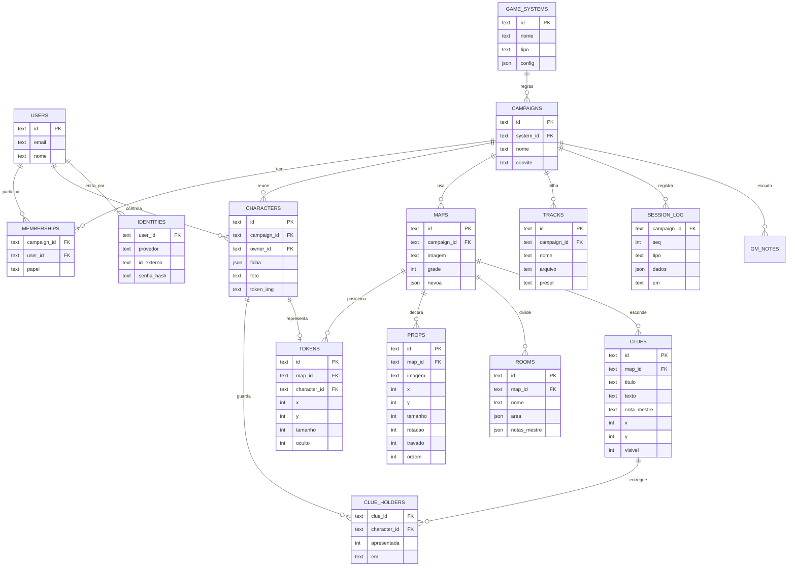

# Arquitetura técnica

Nov 18, 2026 · @Guilherme

## Visão geral

A LIMIAR roda como um único app Node com banco SQLite num servidor pequeno, feito para um grupo de amigos jogar RPG de mesa online, começando por Ordem Paranormal II.

Premissas:

- **Grupo:** de 4 a 8 pessoas, uma ou duas campanhas ativas, uma sessão por vez.
- **Custo:** de zero a poucos dólares por mês de hospedagem.
- **Time:** uma pessoa desenvolvendo nas horas livres.

Objetivos:

- **Jogar de verdade:** mesa com mapa, tokens, névoa, dados e ficha funcionando bem no dia da sessão.
- **Código simples:** fácil de entender e mudar, sem serviços que ninguém precisa.
- **Portfólio:** boas práticas onde elas custam pouco, como regras testadas e permissões no servidor.

O protótipo no Claude Design é a referência de telas e comportamentos.

## Requisitos

O que importa é a mesa funcionar bem no dia do jogo e o mestre poder esconder coisas de verdade. Escala e alta disponibilidade ficam de fora.

### Funcionais

O catálogo completo, com códigos de RF-01 a RF-82, está na aba Produto e funcionalidades. Os pontos que mais pesam na arquitetura são:

- **Mesa ao vivo:** tokens que cada jogador move, props, névoa desenhada pelo mestre, salas com notas, dados e chat.
- **Pistas:** marcadores no mapa, envio ao inventário de um jogador e apresentação ao grupo na aba Acontecimentos.
- **Mestre:** guia de cena na mesa e escudo editável, com as mesmas salas nos dois.
- **Mídia:** mapas, props, tokens, fotos e músicas enviados pelo grupo.
- **Trilha sonora:** o mestre toca e todos ouvem, cada um no próprio volume.
- **Sistemas:** Ordem Paranormal II completo e RPGs inventados por configuração.

### Não funcionais

| Requisito | Meta |
| --- | --- |
| Latência da mesa | Movimento aparece para os outros em menos de 200 ms |
| Disponibilidade | No ar nos dias de jogo; manutenção fora desses horários é aceitável |
| Usuários | Até 10 contas e até 8 pessoas conectadas ao mesmo tempo |
| Uploads | Mapas até 20 MB; tokens, fotos e props até 5 MB; músicas até 15 MB |
| Segredos do mestre | Nunca enviados ao navegador de um jogador |
| Dados | Backup diário; no pior caso perde-se um dia |
| Custo | De zero a poucos dólares por mês |

## Arquitetura

Tudo roda num só processo Node: ele entrega as telas, responde à API e mantém a mesa ao vivo, com o banco e as imagens no disco do mesmo servidor.

> Diagrama: arquitetura · um servidor Node com SQLite, uploads e backup. Está só no [documento original](https://claude.ai/artifact/HbsQrCdY2GKt2kfP3mcYGj); a exportação para Markdown não leva diagramas.

A mesa ao vivo é a peça central: é ela que valida cada ação e esconde o que o mestre não revelou.

- **Navegador → Caddy → Node:** HTTPS para páginas e API; WebSocket (Socket.IO) para a mesa. O Caddy emite e renova o certificado sozinho.
- **Node → SQLite:** tudo o que é oficial, num arquivo só, sem servidor de banco separado.
- **Node → pasta de uploads:** mapas, props, tokens, fotos e músicas, com as imagens já reduzidas na hora do envio.
- **Trilha sonora:** o servidor só manda o comando (tocar, parar, volume); cada navegador toca o áudio por conta própria.
- **Backup:** um cron copia o banco e os uploads para fora do servidor todo dia.
- **Regras compartilhadas:** o mesmo código roda na ficha e no servidor, então os dois nunca discordam.

## Estrutura do código

Um repositório com três pastas (pnpm workspaces): o cliente, o servidor e o código que os dois compartilham.

```text
limiar/
  client/              React + Vite, PWA
    src/pages/         Central, Casos, NovoCaso, Criar, Ficha, Mesa, Mestre, Arquivo, Perfil
    src/mesa/          mapa com Konva: camadas de mapa, grade, props, salas, névoa, pistas, tokens
    src/mesa/audio/    trilha: ambientes gerados (Web Audio) e arquivos enviados
  server/
    src/http/          rotas Fastify: login, campanhas, fichas, uploads, áudio
    src/mesa/          salas Socket.IO, estado em memória, projeção por papel
    src/db/            Drizzle + SQLite, migrações
  shared/
    regras/op2/        Ordem Paranormal II: testes, críticos, perfis, desafios
    regras/inventado/  sistemas da casa resolvidos por configuração
    schemas/           Zod: comandos, eventos, ficha, pista, prop
    permissoes.ts      quem pode o quê
  data/                limiar.db e uploads/ (fora do Git)
```

Organize o servidor por assunto (campanhas, personagens, mesa, caso), não por tipo de arquivo. Mesmo num app pequeno, isso evita que tudo acabe numa pasta `utils` e deixa fácil achar onde mexer.

## Motor de regras

As regras são funções puras em `shared/regras`: a ficha mostra o resultado na hora, e o servidor roda a mesma função para dar a palavra final.

```ts
export function resolverTeste(
  entrada: { atributo: Dado; pericia: Dado; extras: Dado[]; dt: number },
  rng: () => number,            // no servidor, crypto; nos testes, semente fixa
): ResultadoTeste {
  // rola até 4 dados, soma os 3 maiores,
  // detecta sucesso crítico (dois iguais ≥ 6) e falha crítica (todos em 1),
  // devolve total, RA, RB e o veredito
}
```

- **Dados rolados no servidor:** a ficha pode mostrar uma prévia, mas o resultado oficial vem do servidor e fica no registro da sessão.
- **Ficha validada:** a ficha é guardada como JSON com `versao` e validada por um schema Zod na entrada e na saída.
- **Habilidades como dados:** a Gambiarra (+d4 em Máquinas ou Crime, custa 2 PV, uma vez por cena) é um modificador com custo e limite, não um caso especial na tela.
- **RPGs inventados:** `shared/regras/inventado` lê a configuração do caso (dado principal, atributos) e resolve os testes. Um sistema novo do grupo não exige código novo; as regras ficam na aba Regras do jogo.

## Mesa ao vivo

Cada campanha é uma sala do Socket.IO. O servidor guarda o estado da mesa em memória, valida cada ação e manda a cada pessoa só o que ela pode ver.

### Caminho de uma ação

1. O jogador arrasta o token de Davi; a tela já mostra o movimento e envia `token.move`.
2. O servidor confere se ele é o dono do token (ou o mestre) e se o destino não está coberto pela névoa.
3. Se válido, atualiza o estado em memória, dá um número de sequência ao evento e o anota no registro.
4. Envia o evento a cada pessoa da sala, filtrado pelo papel dela.
5. Se recusado, só o autor recebe a recusa e o token volta ao lugar.
6. Um segundo depois da última mudança, o estado é salvo no SQLite.

### O que cada um recebe

Segredo só escondido na tela não é segredo: qualquer amigo curioso abre o F12. Por isso uma função `projetarPara(usuario, estado)` monta o que vai para cada pessoa.

| Dado | Mestre | Jogador |
| --- | --- | --- |
| Tokens ocultos e tokens sob a névoa | Recebe | Não recebe |
| Formas da névoa | Recebe | Recebe, para desenhar o preto |
| Notas das salas e descrições contextuais | Recebe | Não recebe |
| Pistas ainda não descobertas | Recebe | Recebe só a tarja |
| Pistas no mapa marcadas como ocultas | Recebe | Não recebe |
| Nota do mestre de uma pista | Recebe | Nunca recebe |
| Pistas no inventário de um jogador | Recebe todas | Só as próprias e as que foram apresentadas |
| Props (imagens sobre o mapa) | Recebe | Recebe; só o mestre altera |
| Faixa tocando e momento de início | Recebe | Recebe; o volume é de cada um |
| Guia de cena e escudo | Recebe | Nunca recebe |
| Rolagens secretas e sussurros | Recebe | Só o destinatário |

A imagem do mapa vai inteira, então alguém decidido consegue ver o que está sob a névoa abrindo o arquivo. Para um cômodo realmente secreto, o mestre sobe uma segunda imagem e só a mostra quando revelar.

### Detalhes que evitam dor de cabeça

- **Reconexão:** quando alguém cai e volta, o servidor manda o estado completo daquela pessoa. Com uma mesa pequena, isso é mais simples que reenviar eventos.
- **Arrasto:** a posição durante o arrasto vai no máximo 20 vezes por segundo e não é gravada; só a posição final vira evento. Vale para tokens e props.
- **Reinício do servidor:** ao subir, o servidor carrega o último estado salvo de cada campanha. No máximo o último segundo se perde.
- **Textos longos:** o diário, o guia de cena e as notas do escudo são salvos por campo, sem edição simultânea. Se dois editarem o mesmo texto, vale o último, o que basta para um grupo.
- **Trilha sonora:** o evento `audio.changed` leva a faixa, o volume geral e o horário de início no relógio do servidor; quem entra no meio começa do ponto certo. Navegadores bloqueiam som sem um clique, então a mesa mostra um botão “Ativar som” na primeira vez.
- **Pista apresentada:** apresentar não tira a pista do inventário de quem a tinha; vira uma entrada no registro da sessão e passa a ser visível para todos.
- **Dados físicos:** o modo fica na ficha (campo `modo_dados`). No modo físico o servidor não rola: recebe `test.report` com o valor de cada dado, e o próprio servidor calcula soma, críticos e veredito com as regras compartilhadas; ou só com o veredito, a soma opcional e o maior e o menor dado quando o teste pede. Nos dois casos vai junto o d8 e o d4 da falha crítica. Ele aplica as mesmas consequências de `test.resolve` e grava no registro com a origem, para o mestre distinguir. Quando o jogador cancela, nada é enviado.

## Comandos e eventos da mesa

O cliente só envia comandos e o servidor só envia eventos, todos com schema Zod em `shared/schemas`. São 18 grupos de comandos.

| Comando do cliente | Evento do servidor | Quem pode | Quem recebe |
| --- | --- | --- | --- |
| `token.move` | `token.moved` | Dono do token ou mestre | Quem vê o token |
| `token.drag` | `token.dragging` (não grava) | Dono do token ou mestre | Quem vê o token |
| `token.create`, `token.update`, `token.delete` | `token.changed` | Mestre; jogador só troca imagem e tamanho do próprio | Conforme a visibilidade |
| `prop.create`, `prop.update`, `prop.delete` | `prop.changed` | Mestre | Todos |
| `fog.add`, `fog.reveal`, `fog.remove` | `fog.changed` | Mestre | Todos (jogador recebe só as formas) |
| `map.activate` | `map.activated` | Mestre | Todos |
| `room.update` | `room.updated` | Mestre | Só o mestre |
| `clue.create`, `clue.update`, `clue.delete` | `clue.changed` | Mestre | Mestre; jogadores só se a pista estiver visível |
| `clue.send`, `clue.revoke` | `clue.received`, `clue.revoked` | Mestre | Mestre e o jogador da pista |
| `clue.take` | `clue.received` | Jogador perto de uma pista visível | Mestre e quem pegou |
| `clue.present` | `clue.presented` | Jogador que tem a pista | Todos |
| `dice.roll` | `dice.rolled` | Todos | Todos, ou só o mestre se secreta |
| `test.resolve` | `test.resolved` | Jogador na própria ficha; mestre | Todos |
| `test.report` | `test.resolved` (origem: dados físicos) | Jogador no modo físico, só para a própria ficha | Todos; o mestre vê que foi informado |
| `poi.investigate` | `poi.infoRevealed` | Jogador | Quem tem acesso à pista |
| `audio.play`, `audio.stop`, `audio.volume` | `audio.changed` | Mestre | Todos |
| `chat.send` | `chat.message` | Todos | Todos, ou só o destinatário |
| `round.end` | `round.started` | Mestre | Todos |

Com Socket.IO, o envio fica assim:

```ts
// cliente
socket.emit('cmd', { type: 'token.move', tokenId: 'tok_davi', x: 500, y: 340 }, (resp) => {
  if (!resp.ok) desfazerMovimento(resp.motivo);
});

// servidor
socket.on('cmd', (cmd, responder) => {
  const r = mesa.aplicar(usuario, Comando.parse(cmd)); // valida, aplica, gera eventos
  responder(r.ok ? { ok: true } : { ok: false, motivo: r.motivo });
  for (const s of sala.sockets) s.emit('evt', projetarPara(s.usuario, r.eventos));
});
```

## Modelo de dados

Um arquivo SQLite guarda tudo, com tabelas normais para o que tem relação (campanhas, membros, tokens) e colunas JSON para o que muda por sistema de jogo (fichas, estado da névoa).



- **Modo WAL ligado:** leituras e escritas não se bloqueiam, e o backup pode copiar o banco com o app rodando.
- **Notas do mestre separadas:** `rooms.notas_mestre`, `clues.nota_mestre` e `gm_notes` nunca entram nas respostas para jogadores.
- **Pistas:** `clues` guarda a pista no mapa; `clue_holders` diz quem a tem e se ela já foi apresentada ao grupo. Enviar, revogar e apresentar mexem só nessa tabela.
- **Sistemas:** `game_systems` tem uma linha para Ordem Paranormal II e uma para cada RPG inventado. O campo `config` guarda dado principal, atributos e regras da casa; a ficha valida contra ele.
- **Registro da sessão:** `session_log` guarda rolagens, pistas apresentadas e eventos importantes para a aba Acontecimentos e o resumo da sessão.
- **Migrações:** feitas com Drizzle e versionadas no Git; nunca altere o banco à mão.

## Uploads de mapa, prop, token, foto e música

O arquivo sobe para o próprio servidor, é reduzido na hora e só é entregue a quem está na campanha.

1. O navegador envia o arquivo para `POST /campanhas/:id/uploads` (`@fastify/multipart`), com limite de 20 MB para mapas, 5 MB para props, tokens e fotos e 15 MB para músicas.
2. O servidor confere o papel: só o mestre sobe mapas, props e músicas; cada jogador sobe a foto e o token do próprio personagem.
3. O `sharp` confere se é mesmo uma imagem, remove metadados (como localização) e converte para WebP. Tokens viram 256 × 256 px; mapas ficam com no máximo 4096 px no lado maior.
4. O arquivo é salvo em `data/uploads/` com o hash do conteúdo no nome, e a referência vai para o banco.
5. A rota `GET /arquivos/:hash` confere se a pessoa pertence à campanha antes de entregar, com cache longo no navegador.

Props são a exceção na conversão: viram PNG de até 1024 px, para manter o fundo transparente. Músicas (MP3, OGG ou WAV) não são convertidas; o servidor confere o tipo, guarda o arquivo como veio e o entrega com suporte a `Range`, para o navegador começar a tocar sem baixar tudo.

## Login, permissões e segurança

Entre amigos o risco é baixo, mas o servidor fica na internet: o login precisa ser sério e cada permissão é decidida no servidor.

- **Login:** duas formas de entrar na mesma conta, decididas em 19/11/2026. E-mail e senha, com hash Argon2id, senha de pelo menos 10 caracteres e limite de tentativas por IP e por e-mail. E Discord por OAuth. A tabela `identities` liga cada forma de entrar ao usuário. Recuperar a senha por e-mail fica para depois; até lá, o mestre reseta a senha à mão.
- **Sessão:** cookie `httpOnly`, `Secure` e `SameSite=Lax`, verificado também na conexão do Socket.IO.
- **Convites:** link com código de uso limitado, que coloca a pessoa na campanha como jogadora.
- **Permissões num arquivo só:** `shared/permissoes.ts` responde “pode mover este token?”, “pode ver esta nota?” e é usado pelas rotas e pela mesa.
- **Limites básicos:** tamanho máximo de upload, de mensagem e de comandos por segundo, para um bug não derrubar o servidor.
- **Servidor:** SSH só com chave, firewall liberando apenas as portas 22, 80 e 443, atualizações automáticas de segurança.

**Uso de Ordem Paranormal:** para jogar em particular com o grupo, o risco é baixo. Se um dia o app for publicado ou cobrado, é preciso licença dos detentores do sistema.

## Hospedagem, deploy e backup

Decidido em 19/11/2026: um VPS pequeno com Linux, onde o app roda como serviço do systemd atrás do Caddy. Fica sempre no ar e custa de zero a poucos dólares por mês.

| Opção | Custo | Quando usar |
| --- | --- | --- |
| VPS pequeno (Hetzner, Oracle Free Tier e similares) | Grátis a poucos dólares por mês | Recomendado: sempre no ar e você controla tudo |
| Fly.io ou Railway | Poucos dólares por mês | Se não quiser administrar Linux; exige volume persistente para o SQLite |
| Seu PC + Cloudflare Tunnel | Grátis | Para começar a testar; só funciona com o PC ligado |

### Montagem do servidor

1. Criar o servidor com uma distribuição Linux de longo suporte, um usuário sem root e login SSH só por chave.
2. Ligar o firewall com as portas 22, 80 e 443, e as atualizações automáticas de segurança.
3. Instalar o Node LTS e criar o serviço `limiar.service` no systemd, com reinício automático.
4. Instalar o Caddy apontando o domínio para `localhost:3000`; ele cuida do HTTPS.
5. Agendar o backup: um timer do systemd (ou cron) roda `sqlite3 limiar.db ".backup"` e o `rclone` envia o banco e os uploads para o Google Drive todo dia, mantendo 14 cópias.

### Deploy

Um script `deploy.sh` faz `git pull`, `pnpm install`, `pnpm build`, roda as migrações e reinicia o serviço. Mais tarde, um GitHub Actions pode rodar os testes e chamar o script por SSH a cada push na `main`.

### Acompanhamento

- **Logs:** `journalctl -u limiar` mostra tudo o que o app escreveu.
- **Erros:** o plano gratuito do Sentry avisa quando algo quebra durante a sessão.
- **Fora do ar:** um monitor gratuito (UptimeRobot ou similar) manda alerta se o site cair.
- **Teste do backup:** uma vez por mês, restaure o backup numa máquina local para garantir que ele funciona.

## Testes

Poucos testes, nos lugares onde um bug estraga a sessão: as regras, as permissões e o fluxo principal da mesa.

| O quê | Ferramenta | Exemplos |
| --- | --- | --- |
| Regras | Vitest (+ fast-check, opcional) | Soma dos 3 maiores, críticos, passos de dado, Gambiarra, Ímpeto |
| Permissões | Vitest | Jogador não move token alheio; jogador nunca recebe nota de sala nem token oculto |
| Mesa | Vitest com dois clientes Socket.IO falsos | Movimento chega ao outro; destino na névoa é recusado; reconexão recebe o estado |
| Ponta a ponta | Playwright | Entrar por convite, abrir a mesa, mover o token, rolar um teste |

O teste de permissão que verifica o que o jogador recebe é o mais valioso: é ele que garante que o mestre consegue manter surpresas.

## Se o grupo crescer

Um processo Node aguenta centenas de conexões e o SQLite aguenta milhares de escritas por segundo, então o grupo dificilmente vai esbarrar em limite. Os sinais para mudar são outros:

- **Outros grupos querendo usar:** aí entram cadastro aberto, cotas de upload e termos de uso.
- **Disco do VPS enchendo de mapas:** mova os uploads para um storage de objetos (Cloudflare R2 ou Backblaze B2).
- **Mais de um servidor:** troque o SQLite por PostgreSQL e coloque o Redis como adaptador do Socket.IO.

A versão anterior deste documento, para muitos usuários (salas isoladas, filas, CDN), fica no histórico de versões como referência. A estrutura de pastas e as regras compartilhadas desta versão já facilitam essa mudança.

## Decisões de arquitetura

Nove decisões definem o projeto. Todas puxam para o mais simples que ainda funciona bem no dia do jogo.

| Nº | Decisão | Alternativa descartada | Motivo |
| --- | --- | --- | --- |
| 1 | Um só processo Node | API e tempo real separados | Um grupo de amigos não precisa de mais; um deploy, um log, um lugar para depurar |
| 2 | SQLite | PostgreSQL | Zero administração, backup é copiar um arquivo, desempenho de sobra |
| 3 | Socket.IO | WebSocket puro ou serviço gerenciado | Salas, reconexão e confirmação de envio prontos |
| 4 | Servidor valida e rola os dados | Tudo no navegador | Regra num lugar só e segredos do mestre protegidos |
| 5 | Regras em código compartilhado | Regras só no servidor | Ficha responde na hora com a mesma lógica oficial |
| 6 | Konva para o mapa | PixiJS, ou DOM como no protótipo | Mais simples de usar com React; aguenta mapas e tokens de um grupo |
| 7 | VPS com systemd e Caddy | Plataforma gerenciada | Custo mínimo e prática de Linux; Fly.io fica como alternativa |
| 8 | Trilha por comando; cada navegador toca o próprio áudio | Transmitir o áudio do mestre ao vivo | Sem servidor de mídia, sem atraso acumulado e com volume individual |
| 9 | RPGs inventados por configuração | Um módulo de código por sistema | Criar um sistema da casa vira preencher um formulário, sem deploy |

## Plano

Trabalhando umas 8 a 10 horas por semana, o grupo joga a primeira sessão de verdade na plataforma depois de cerca de 12 semanas, e o resto vem com o jogo já rodando. São estimativas para uma pessoa só, sem prazo fixo.

> Diagrama: plano · 5 fases, cerca de 24 semanas. Está só no [documento original](https://claude.ai/artifact/HbsQrCdY2GKt2kfP3mcYGj); a exportação para Markdown não leva diagramas.

A ordem existe para jogar cedo: depois da fase 2, use a plataforma nas sessões e deixe o grupo dizer o que falta. Enquanto isso, nada impede de jogar no Owlbear Rodeo.

## Riscos e questões em aberto

O maior risco é o projeto ficar grande demais para uma pessoa e o grupo nunca chegar a jogar nele. Por isso o plano põe a primeira sessão real o mais cedo possível.

| Risco | Resposta |
| --- | --- |
| Escopo grande demais para as horas livres | Jogar depois da fase 2 e só construir o que o grupo sentir falta |
| Servidor cair no dia do jogo | Testar na véspera; ter o backup e um script que reinstala tudo do zero |
| Perder campanhas e fichas | Backup diário fora do servidor, testado uma vez por mês |
| Servidor invadido por estar exposto | SSH só com chave, firewall, atualizações automáticas, nada rodando como root |
| Névoa e mapa ficarem lentos no celular | Limitar o mapa a 4096 px e testar cedo no celular mais fraco do grupo |
| Navegador bloquear o som | Botão “Ativar som” na entrada da mesa e aviso quando o áudio estiver bloqueado |
| Pistas ou notas do mestre vazarem | Projeção por papel testada: o teste confere que o jogador nunca recebe pista oculta, nota de pista ou guia de cena |

Questões para decidir:

- [x] Onde hospedar: decidido em 19/11/2026, VPS.
- [x] Login: decidido em 19/11/2026, e-mail e senha e também Discord, na mesma conta.
- [ ] Voz continua no Discord, ou vale integrar chamada na mesa depois?
- [ ] Linha de visão dinâmica (paredes que bloqueiam a visão) entra em algum momento, ou a névoa manual basta?
- [ ] Alguém além de você vai mestrar e precisa do escudo?
